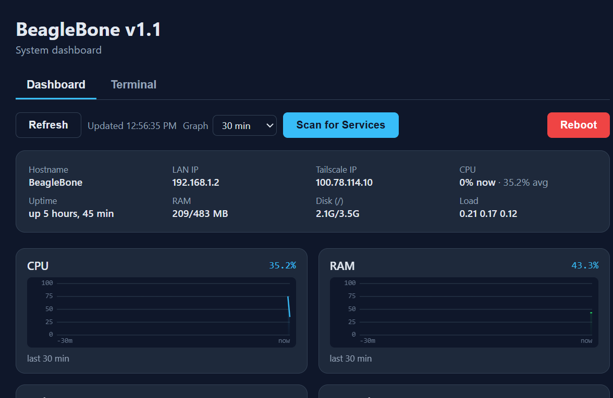

# Linux Dashboard

A **single-file, dependency-free** web dashboard for any systemd Linux machine. Watch CPU,
RAM, disk and network for up to 24 hours, control systemd services, and open a root shell in
the browser — from a phone, tablet or desktop.

[](https://www.python.org/)
[](.)
[](LICENSE)
[](.)



Built for small boards (BeagleBone, Raspberry Pi, Armbian boxes, thin clients) but runs the
same on a VM, an old laptop or a full server. One Python file, standard library only: no pip,
no Node, no CDN, no database, no Docker.

## Why this instead of Netdata / Grafana / Cockpit?

| | **Linux Dashboard** | Netdata | Grafana + Prometheus | Cockpit |
|---|---|---|---|---|
| Install size | ~75 KB, 1 file | ~100 MB+ | hundreds of MB | ~30 MB |
| Dependencies | none (Python stdlib) | many | many | many |
| RAM on a 483 MB board | ~12 MB | 100–200 MB | 200 MB+ | 50 MB+ |
| Service start/stop/restart/enable | ✅ built in | ❌ | ❌ | ✅ |
| Browser root console | ✅ built in | ❌ | ❌ | ✅ |
| PIN-gated credentials | ✅ built in | ❌ | ❌ | users/roles |
| Works offline, no CDN assets | ✅ | ✅ | ✅ | ✅ |

It is deliberately small: everything is plain HTTP, plain canvas and plain text, so it stays
usable on a 1-core ARM board and on ancient mobile browsers.

## Features

- **System panel** — hostname, LAN and Tailscale IPs, uptime, load, RAM, disk (used/total),
  CPU `X% now · Y% avg`.
- **Graphs** — CPU, RAM, disk and network RX/TX. Window selectable from **10 minutes to
  24 hours** (30 minutes by default), persisted across restarts.
- **Network interface picker** — graph `wlan0`, `eth0`, any other interface, the interface
  carrying the default route (auto), or **all interfaces combined**. Live IP / Wi-Fi state
  shown in the dropdown.
- **Service cards** — live `active / inactive / failed` state, enabled/disabled, port, and
  start / stop / restart / enable / disable / remove. Slow SysV units are handled (90 s
  timeouts) and the result is verified against the real unit state.
- **Scan for services** — lists every listening TCP port with the systemd unit that owns it
  (resolved through the PID's cgroup, no name guessing) and adds a card in two clicks.
- **Credentials** — per-service username/password notes, hidden until unlocked.
- **Browser console** — a real interactive bash session over HTTP polling: history, arrows,
  Ctrl+C, Ctrl+D. No websocket, no xterm.js, no ANSI parser in the browser.
- **PIN gate** — console, credentials and reboot need a 4-digit PIN checked **server-side**
  (it never appears in the page source). Sessions get a 12 h token.
- **Reboot** with confirmation and PIN.
- **Portable** — auto-detects services, IPs and interfaces at install time; config is a
  single JSON file.

## Requirements

| | |
|---|---|
| OS | Linux with systemd (Debian/Ubuntu, Raspberry Pi OS, Armbian, Fedora, Arch, …) |
| Runtime | `python3` ≥ 3.7, standard library only |
| Tools | `systemctl`, `ss` (iproute2), `ip`, `hostname`, `/proc`, `/sys` — all standard |
| Privileges | install as root; the service runs as root so it can control systemd and open a root console |
| Optional | `nginx` if you want the dashboard on port 80 |

## Install

### One line (recommended)

```bash
curl -fsSL https://raw.githubusercontent.com/comradesengineer/linux-dashboard/main/install.sh | sudo bash
```

With options (port, title, PIN, nginx, …):

```bash
curl -fsSL https://raw.githubusercontent.com/comradesengineer/linux-dashboard/main/install.sh \
  | sudo bash -s -- --port 7979 --title "Pi 4" --pin 1234
```

`wget` works too: `wget -qO- <url> | sudo bash`.

### From a release tarball

```bash
curl -fsSLO https://github.com/comradesengineer/linux-dashboard/releases/latest/download/linux-dashboard.tar.gz
tar -xzf linux-dashboard.tar.gz
cd linux-dashboard
sudo ./install.sh
```

### From a git clone

```bash
git clone https://github.com/comradesengineer/linux-dashboard.git
cd linux-dashboard
sudo ./install.sh
```

The installer:

1. installs `dashboard.py` to `/usr/local/bin/dashboard.py`;
2. scans listening services and writes `/etc/dashboard/config.json` (mode 600);
3. generates a random 4-digit PIN (or uses `--pin`);
4. creates and starts `dashboard.service`;
5. prints the URL and PIN.

```
  Dashboard : http://192.168.1.50:7979
  PIN       : 4821
  Config    : /etc/dashboard/config.json
  Services  : 6 detected
  Service   : systemctl status dashboard
```

Open the URL and enter the PIN when prompted for the console, credentials or reboot.

### Flags

```bash
sudo ./install.sh --port 8080            # different port
sudo ./install.sh --title "Living Room"  # dashboard title
sudo ./install.sh --pin 1234             # fixed PIN (default: random)
sudo ./install.sh --bind 127.0.0.1       # loopback only (put a proxy in front)
sudo ./install.sh --nginx                # also proxy http://host/ via nginx
sudo ./install.sh --prefix /opt/dash --no-systemd   # user-local, run by hand
sudo ./install.sh --uninstall            # remove unit + binary, keep config
sudo ./install.sh --uninstall --purge    # also delete /etc/dashboard
```

Run the installer with `sudo`, otherwise it can only see services owned by your own user
when it scans for cards. A `--prefix` install writes only into that directory; remove it by
deleting the directory.

## Using the dashboard

### Dashboard tab

- **System panel** – identity and live totals. `CPU` shows the last sample (`now`) and the
  15 s average from the sampler.
- **Graph selector** – top toolbar: `Graph: 30 min` … `24 hours`. Changing it resets the
  window immediately and is saved in the config.
- **Network card** – the dropdown chooses the interface to graph:
  `Auto · wlan0` (default-route interface), `wlan0 · Wi-Fi · 192.168.1.50`, `eth0`,
  `All interfaces`. The choice is saved server-side.
- **Service cards** – `Open` opens the service URL (if one is known), the buttons act on the
  systemd unit. `Protected` cards (SSH, network managers, nginx) show no stop/disable
  buttons. `+ Add Creds` stores notes revealed only after the PIN.
- **Scan for Services** – shows listening ports, the owning unit, and an `Add` button for
  ports not yet on the dashboard.
- **Reboot** – asks for the PIN and a confirmation, then reboots.

### Terminal tab

`Connect` (PIN required) starts a root bash. Type a command and press Enter. Buttons provide
Tab, arrows, Ctrl+C and Ctrl+D. Up to 4 sessions; the oldest is closed when a fifth connects.
Full-screen apps (`htop`, `vim`) do not render — use it for commands, logs and service work,
not as a full terminal emulator.

## Configuration

`/etc/dashboard/config.json` (mode 600 — it contains the PIN and credentials):

```json
{
  "title": "my-server",
  "subtitle": "System dashboard",
  "pin": "1234",
  "port": 7979,
  "bind": "0.0.0.0",
  "disk_path": "/",
  "net_iface": "",
  "history_minutes": 30,
  "protected": ["ssh", "sshd", "NetworkManager", "nginx"],
  "services": [
    {
      "name": "jellyfin",
      "label": "Jellyfin",
      "port": 8096,
      "url": "http://192.168.1.50:8096",
      "icon": "JEL",
      "desc": "media server",
      "safe": true,
      "creds": {"user": "admin", "pass": "secret"}
    }
  ]
}
```

| key | meaning |
|---|---|
| `pin` | 4-digit PIN for console/credentials/reboot. Empty = console stays locked |
| `port`, `bind` | listen address; CLI `--port` / `--bind` override |
| `disk_path` | filesystem shown in the system panel and disk graph (e.g. `/mnt/data`) |
| `net_iface` | interface to graph: `""` = auto (default route), `"wlan0"`, `"all"` |
| `history_minutes` | graph window in minutes: 10, 30, 60, 180, 360, 720 or 1440 |
| `protected` | unit names that can never be stopped/disabled from the UI |
| `services[].safe` | per-card override; `false` hides action buttons |
| `services[].creds` | optional login notes, masked until the PIN is entered |

Changes apply on the next request except `port` / `bind` (restart the service).

### Graph ranges

The server keeps 120 samples and derives the sampling interval from the window:

| Window | Sample interval |
|---|---|
| 10 min | 5 s |
| 30 min (default) | 15 s |
| 1 hour | 30 s |
| 3 hours | 90 s |
| 6 hours | 3 min |
| 12 hours | 6 min |
| 24 hours | 12 min |

Samples are written to `<config dir>/dashboard_history.json`, so a restart keeps the graph.
Changing the window or interface starts a fresh graph.

## HTTP API

All endpoints return JSON. Send `X-Dash-Token` for token-gated routes (header value returned
by `/api/unlock`).

| Method | Path | Notes |
|---|---|---|
| GET | `/api/config` | config without the PIN or credentials |
| GET | `/api/sysinfo` | hostname, IPs, uptime, load, RAM, disk, CPU |
| GET | `/api/services` | cards with live unit state |
| GET | `/api/scan` | listening TCP ports + owning process |
| GET | `/api/history` | points, interval, span, selected interface |
| GET | `/api/net` | interfaces, current selection, range options |
| POST | `/api/unlock` | `{"pin": "1234"}` → `{"token": "…"}` (rate-limited) |
| POST | `/api/settings` | `{"net_iface": "eth0"}` or `{"history_minutes": 60}` |
| POST | `/api/services/{name}/{start,stop,restart,enable,disable,remove}` | not PIN-gated |
| POST | `/api/services/add` | add a card |
| GET/POST | `/api/term/{start,read,write,resize,close}` | token required |
| GET/POST | `/api/creds/{name}` | token required |
| POST | `/api/reboot` | token required |

## Security

- The dashboard speaks **plain HTTP**. Run it on a trusted LAN, or expose it only through
  Tailscale / WireGuard, or terminate TLS in nginx. With Tailscale you can get a real
  certificate for free:
  ```bash
  sudo tailscale cert your-host.your-tailnet.ts.net
  ```
  and point nginx at the generated key/certificate.
- The PIN protects the console, credentials and reboot. It is **not** a user system: anyone
  who can reach the port can start/stop services that are not in `protected`.
- The web console runs as **root** when the service runs as root. Treat the PIN like a root
  password.
- Tokens live in memory: restarting the service logs everyone out.
- Add anything you must not accidentally stop (`ssh`, network managers, reverse proxy) to
  `protected`.
- The config contains the PIN and credentials in plaintext, so it is mode 600 and owned by
  root. Backups of `/etc/dashboard` should be protected the same way.

## Port choice

The default port is **7979**. It is not registered with IANA for a common service and avoids
the usual homelab collisions:

| Port | Usually taken by |
|---|---|
| 80 / 443 | nginx, Apache, reverse proxies |
| 3000 | Grafana, Node apps |
| 5000 | Flask, UPnP |
| 8000 / 8080 | dev servers, proxies, SABnzbd |
| 8086 | InfluxDB |
| 8096 | Jellyfin |
| 8123 | Home Assistant |
| 8384 | Syncthing |
| 8989 / 7878 | Sonarr / Radarr |
| 9000 / 9443 | Portainer |
| 9090 / 9091 | Prometheus / Transmission |
| 9696 | Prowlarr |
| 32400 | Plex |

If something already uses 7979, pick another with `--port`.

## Run without installing

```bash
python3 dashboard.py --detect --port 7979 > config.json   # auto-detect services
python3 dashboard.py --config config.json --port 7979
```

Then open `http://<host>:7979`. Add `DASH_PIN=1234` to the environment to embed a PIN in the
detected config. Use `--detect` as root for a complete list.

## Upgrade

```bash
curl -fsSL https://raw.githubusercontent.com/comradesengineer/linux-dashboard/main/install.sh | sudo bash
```

The installer keeps an existing `/etc/dashboard/config.json` and only patches the values you
pass, so upgrades keep your PIN, cards and settings. Or replace the binary only:

```bash
sudo curl -fsSL https://raw.githubusercontent.com/comradesengineer/linux-dashboard/main/dashboard.py \
  -o /usr/local/bin/dashboard.py && sudo systemctl restart dashboard
```

## Troubleshooting

| Symptom | Fix |
|---|---|
| `port 7979 is already in use` | `sudo ./install.sh --port 8080` |
| No service cards after install | install with `sudo` (non-root detection only sees your own processes) |
| `dashboard failed to start` | `journalctl -u dashboard -n 50` |
| Services show `unknown` | the unit name in the config is wrong: `systemctl status <name>` |
| Graph is empty after changing range | expected — a new window starts a new graph |
| Console says "cannot reach host" | the service stopped or the network changed; check `systemctl status dashboard` |

## Development

No build step. Edit `dashboard.py`, then:

```bash
python3 -m py_compile dashboard.py
bash -n install.sh
python3 dashboard.py --detect --port 7979 | python3 -m json.tool
```

The page is a single HTML string with inline CSS/JS; the only substitution at serve time is
`__APP_VERSION__`.

## License

MIT — see [LICENSE](LICENSE).
